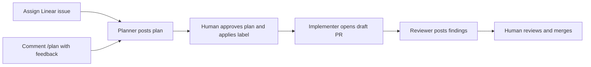

# Paseo Hub: onboard a new project

Use Linear for planning and approval, a connected Paseo daemon for execution, and GitHub for review. One Linear project maps to one GitHub repository. The [templates](templates/) are configuration examples; nothing is deployed from this directory.



## 1. Prepare the project

- **Daemon:** Under **Hub → Daemons**, pick a connected daemon with `hub.execute` and note its slug. Clone the target GitHub repo on that host, fetch its default branch, and verify the configured Codex model, `git`, and `gh` are available. Use the checkout's absolute path on the daemon host. Document the test command in the repository's agent instructions if it isn't obvious.
- **Linear:** Under **Hub → Connections**, find the connection slug for your workspace. Set up the issue's project, a **Ready for Implementation** team state, and a **paseo-implement** label. Reuse the state and label when they already exist in the issue's team. Confirm the Linear app sends **Issues** and **Comments** events. Get the IDs from Linear's **Copy model UUID** action or [GraphQL API](https://linear.app/developers/graphql); use `{ viewer { id name } }` with a personal API key to identify the human approver. Keep API keys out of YAML and source control.
- **GitHub:** In the GitHub App installation settings, grant the app access to the new repo. Under **Hub → Connections**, find the active GitHub connection and note its slug. The implementation token needs **Contents: write** and **Pull requests: write**; review needs **Contents: read** and **Pull requests: write**. Keep the installation restricted to selected repos. Use branch protection on the default branch and require human review.

### Connect a new workspace or GitHub account

- **Linear:** If the workspace isn't listed, configure the [Linear OAuth app and webhook](https://paseo.sh/docs/hub/self-hosting/linear-app.md) in **Hub → Apps → Linear** if needed. Then choose **Connect Linear** from **Hub → Connections** and have a Linear workspace admin authorize the target workspace. Use the resulting connection slug in the templates.
- **GitHub:** If the account or organization isn't listed, configure the [GitHub App](https://paseo.sh/docs/hub/self-hosting/github-app.md) in **Hub → Apps → GitHub** if needed. Start **Connect GitHub** from **Hub → Connections**, then install or authorize the app for the target account or organization and select the target repository. Verify the connection is **Active** and use its slug in the templates.

Keep the private dashboard origin (`PASEO_HUB_URL`) and public webhook origin (`PASEO_HUB_WEBHOOK_ORIGIN`, including its HTTPS port) in your ignored local `.envrc`. Load those settings into the shell before running deployment commands from another checkout. The webhook origin is used for provider configuration, not as a CLI endpoint.

### Enable GitHub event delivery once per Hub

The GitHub App connection alone allows token issuance; it does not deliver PR events. The review worker needs the GitHub App's webhook **Active**, subscribed to **Pull requests**, with TLS verification enabled. Set the webhook URL to your `PASEO_HUB_WEBHOOK_ORIGIN` followed by `/webhook` **after** that path is published. Use the same randomly generated webhook secret in GitHub and **Hub → Apps → GitHub**. Keep the private OAuth callback and setup URLs unchanged.

If you use Tailscale Funnel, this example publishes only the GitHub webhook on public HTTPS port `8443` and forwards it to a Hub listening locally on port `3000`. Adjust both ports for your deployment. Run it on the Hub host only after approving public exposure of this path:

```sh
tailscale funnel --bg --https=8443 \
  --set-path=/webhook http://127.0.0.1:3000/webhook
```

Keep any existing Linear webhook route. Verify `tailscale funnel status` exposes only the intended webhook paths and that the dashboard remains private. Check **GitHub App → Advanced → Recent deliveries** for a successful delivery. If GitHub events aren’t ready yet, set `enabled: false` in the review template until they are.

## 2. Copy and configure three triggers

Create `.paseo/triggers/` at the **target repository root**. Copy these templates there as `<project-slug>-plan.yml`, `<project-slug>-implement.yml`, and `<project-slug>-review.yml`. Leave the originals here unchanged.

| Template | Runs when | Result |
|---|---|---|
| [Plan](templates/project-plan.yml) | The approver assigns an existing issue to themselves, or posts `/plan <feedback>` on an issue assigned to them. | Read-only planner posts one Linear reply. Follow-ups use the same issue conversation. |
| [Implement](templates/project-implement.yml) | The approver moves their issue into the configured project, state, and label scope. | Separate worker tests changes in a fresh worktree, opens a draft PR, and reports back in Linear. |
| [Review](templates/project-review.yml) | The allowed human or GitHub App bot opens a PR in this repo, including drafts. | Separate worker reads the diff and posts a comment-only review. It doesn’t run PR code. |

Replace every placeholder, including occurrences in prompts:

| Placeholder | Value |
|---|---|
| `PROJECT_SLUG` | A unique lowercase prefix in the Hub organization, e.g. `my-project`. Changing a YAML name at deploy time creates a separate trigger, not a rename. |
| `LINEAR_CONNECTION`, `GITHUB_CONNECTION` | Integration slugs from **Hub → Connections**, e.g. `workspace-linear` and `organization-github`. |
| `LINEAR_PROJECT_UUID`, `READY_STATE_UUID`, `IMPLEMENT_LABEL_UUID` | Linear project, workflow state, and label UUIDs, respectively. |
| `LINEAR_USER_UUID` | UUID of the assignee and approver. `from_users` is the person acting; `assignees` is who receives the issue. To allow a teammate to start planning, add them only to the assignment event's `from_users`, not to the implementation gate. |
| `DAEMON_SLUG`, `REPO_PATH`, `CODEX_MODEL` | A connected daemon's slug (e.g. `build-host`), the absolute checkout path on that host, and a Codex model the daemon reports. |
| `GITHUB_REPO`, `BASE_BRANCH` | `owner/repo` and the default branch (e.g. `main`, without `origin/`). |
| `GITHUB_USER`, `GITHUB_APP_BOT` | Allowed GitHub login and the app's bot login (`<app-slug>[bot]`). Keep the bot login quoted. |

Leave `${{ paseo.context }}`, `${{ paseo.prompt }}`, and `${{ paseo.execution.id }}` intact: Hub resolves them at runtime. Use the repository YAML as the source of truth. If migrating an existing workflow, disable overlapping triggers before enabling these. Edit a multi-event planner in YAML rather than the single-event form.

## 3. Deploy and test one issue

From the target repo root, load `PASEO_HUB_URL` and authenticate your CLI to that Hub. A connected daemon does not authenticate the CLI. If using an organization API key instead, set `PASEO_HUB_API_KEY` in your shell and skip `paseo hub login`.

```sh
paseo hub login "${PASEO_HUB_URL:?Set your private Hub origin}"
paseo hub status
paseo hub deploy --dry-run --hub "$PASEO_HUB_URL"
paseo hub deploy --hub "$PASEO_HUB_URL"
```

Dry-run validates definitions and agent settings; it does not prove webhook delivery, GitHub token permissions, or the ability to push and post reviews.

1. **Plan:** Assign an existing test issue in the configured project to yourself. Check for a plan in Linear and a run in **Hub → Activity**. Post `/plan <one change>` and verify a revised reply. Plain comments don't invoke the planner.
2. **Implement:** After reviewing the final plan, leave a plain `Plan approved` comment. Move the issue to **Ready for Implementation**, then apply **paseo-implement** yourself as the final action. Verify a draft PR opens and the Linear reply includes its URL and test results. A routine issue edit while it remains in scope does not launch again. Removing and reapplying the label can launch a new run; check Activity and any existing PR before retrying.
3. **Review:** Verify the draft PR receives a comment-only review and Hub records a separate run. The worker stops rather than posting if the PR is closed or its head changed. Read the PR, check CI, and merge only after human review. Mark the Linear issue Done yourself.

## Troubleshoot and roll back

- **No run:** Check provider delivery first. In Hub, **Connections → Known unrouted events** shows accepted events that didn't match. Compare project, connection, actor, assignee, and state or label against YAML. Don't use `Everyone` (`"*"`) for Linear assignments or comments: the matcher requires actual user UUIDs. An issue that's already assigned or in scope won't launch just because a trigger was deployed.
- **Run failed:** Open **Hub → Activity**. Check the daemon, working directory, provider mode, and App repo access. A GitHub installation token is minted at launch, not during dry-run. In Paseo, select the target daemon and open **History** for archived transcripts. The implementation workspace is kept open for inspection.
- **Stop a trigger:** Set `enabled: false` and redeploy under the same name. This prevents new runs; check Activity separately for already-running work. Don't delete YAML and assume that removes a deployed trigger.

The planner is read-only. Implementation and review use workspace-write with networking for GitHub; the review prompt forbids file edits and running PR code, but prompts are not a security boundary. Keep the trigger allowlists narrow, and use a dedicated daemon or OS account if the host holds sensitive unrelated workloads.

References: [Linear triggers](https://paseo.sh/docs/hub/triggers/linear.md) · [GitHub triggers](https://paseo.sh/docs/hub/triggers/github.md) · [GitHub token scope](https://paseo.sh/docs/hub/github.md) · [Trigger deployment](https://paseo.sh/docs/hub/configuration.md).
